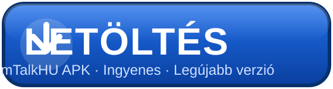

# TeamTalkHU (Android)

> **A TeamTalk 5 Android kliens magyar nyelvű, kiterjesztett kiadása**
> *Teljes szerveradminisztráció, csatorna- és bánkezelés, hang- és videostreaming, TalkBack akadálymentesítés — mind magyarul (hu-HU).*

---

## 📥 LETÖLTÉS

[](https://github.com/romeohorvath/TeamTalkHU/releases/latest/download/TeamTalk.apk)

> A legfrissebb, aláírt APK közvetlenül a legújabb release-ből érkezik. Telepítéshez engedélyezd az „ismeretlen forrásból származó alkalmazások" opciót a telefonodon.

**Kulcsszavak / címkék:** `TeamTalk` · `TeamTalk 5` · `Android` · `VoIP kliens` · `magyar nyelvű` · `APK letöltés` · `hangcsevegés` · `szerveradminisztráció` · `csatornakezelés` · `bánkezelés` · `TalkBack` · `akadálymentesítés` · `voice chat` · `chat alkalmazás` · `TeamTalk szerver`

---

## 🏆 A „PC-ÉLMÉNY" ANDROIDON

**A TeamTalkHU egyetlen filozófiával készült: miért jelentene kevesebbet a mobilos lét?**

A hivatalos TeamTalk 5 Android kliens inkább „könnyű társ", amely hallgatásra és alap csevegésre jó. Szerveradminisztrátoroknak, csatornaoperátoroknak és haladó felhasználóknak viszont sokszor szűkös: nem lehet IP alapján tiltani, nem lehet felhasználói fiókokat kezelni, és nem lehet bonyolult szerverbeállításokat módosítani.

**A TeamTalkHU ezen változtat.**

A **TeamTalk 5 Windows kliens** mély, aprólékos vezérlését ültettük át az Android platformra. Ha megszoktad, hogy a szerveredet asztali gépről kezeled, itt azonnal otthon leszel. Ez nem csak egy kliens: egy teljes értékű adminisztrációs eszköz a zsebedben.

### 🆚 Funkció-összehasonlítás

| Funkció | 🤖 Hivatalos Android | 💠 TeamTalkHU | 💻 TeamTalk Windows |
| :--- | :---: | :---: | :---: |
| **Felhasználói fiók kezelése** | ❌ Nincs | ✅ **Teljes admin** | ✅ Teljes admin |
| **Fiók létrehozása/törlése** | ❌ Nincs | ✅ **Igen** | ✅ Igen |
| **Bánkezelés** | ⚠️ Alap (kick) | ✅ **Fejlett** | ✅ Fejlett |
| **Tiltási típusok** | Csak kick | IP / Név / Csatorna | IP / Név / Csatorna |
| **Szervertulajdonságok** | ❌ Nincs | ✅ **MOTD/Név szerkesztése** | ✅ Teljes hozzáférés |
| **Csatornaadminisztráció** | ⚠️ Korlátozott | ✅ **Teljes vezérlés** | ✅ Teljes vezérlés |
| **Statikus csatornák létrehozása** | ❌ Nincs | ✅ **Igen** | ✅ Igen |
| **Hangfeldolgozás** | ⚠️ Alap | ✅ **Pro (AEC/NS)** | ✅ Pro (AEC/NS) |
| **Mikrofon-érerősítés** | ⚠️ Csak automata | ✅ **Kézi csúszka** | ✅ Kézi csúszka |
| **Nemek és állapotikonok** | ❌ Általános | ✅ **Férfi/Nő/Semleges** | ✅ Férfi/Nő/Semleges |
| **Szövegfelolvasás (TTS)** | ⚠️ Minimális | ✅ **Felhasználó által állítható** | ✅ Felhasználó által állítható |
| **Vakoknak szóló akadálymentesítés** | ⚠️ Alap | ✅ **TalkBack-re optimalizált** | ✅ NVDA/JAWS optimalizált |
| **Navigációs felépítés** | 3 alap fül | **12 professzionális fül** | Több ablak |
| **Bluetooth SCO támogatás** | ❌ Korlátozott | ✅ **Fejlesztett** | N/A |
| **Fájlátvitel** | ⚠️ Csak letöltés | ✅ **Feltöltés/Letöltés/Törlés** | ✅ Feltöltés/Letöltés/Törlés |
| **Nyelv** | ⚠️ Csak angol | ✅ **Magyar (hu-HU)** | ✅ Többnyelvű |
| **Médiastreamelés** | ❌ Nincs | ✅ **Zene streamelése** | ✅ Zene streamelése |

### 🚀 Miért számít a TeamTalkHU (a Windows örökség)

**1. A „12 fül" vezérlőpult**
Windowson külön ablakokban él a Csevegés, a Fájlok és a Szerverstatisztika. Kis telefonképernyőn ez lehetetlen lenne — a TeamTalkHU ezt egy **12 oldalas, húzással lapozható felülettel** oldja meg. Ez a „Multi-Window" többablakos munkát utánozza: az „Eseménynapló" (6. oldal) és az „Online felhasználók" (11. oldal) között ugyanúgy váltogathatsz, mint az asztali gépen az Alt+Tabbal.

**2. Valódi szerveradminisztráció**
Ha egy troll belép a szerveredre, a hivatalos kliensben kevés eszközöd van. A TeamTalkHU **Szerverkezelés (4. oldal)** fülén teljes körűen eléred a `USERRIGHT_BAN_USERS` és `USERRIGHT_KICK_USERS` jogosultságokat. Nem csak „kirúgod" a felhasználót: az IP-címét kitilthatod a teljes szerverről, vagy egy adott csatornából zárhatod ki — pontosan, mint Windowson.

**3. Hangmérnökség mobilra**
A Windows kliens híres kristálytiszta hangbeállításairól. A TeamTalkHU Androidra is elhozza a **Hangfeldolgozást**: kézzel kapcsolhatod a visszhangkioltást (AEC), a zajszűrést (NS) és az automatikus hangerőszabályzót (AGC) — így már mobilon is „stúdióminőségű" hangot kapsz.

**4. 100%-os szintaktikai kompatibilitás**
A TeamTalkHU pontosan ugyanazt a `strings.xml` szerkezetet és hibakódokat használja, mint a Windows kliens. Ha olyan hibát látsz, mint a `MAX_USERS_EXCEEDED`, vagy olyan jogosultságot, mint a `USERRIGHT_OPERATOR_ENABLE`, az pontosan az, amit évek óta ismersz a PC-s dokumentációból. Nem kell új „mobil appnyelvet" tanulnod.

---

## ♿ AKADÁLYMENTESÍTÉSI ÚTMUTATÓ (TalkBack és képernyőolvasók)

Az alkalmazás a nulláról úgy készült, hogy „100%-ban akadálymentes" legyen az Android kisegítő szolgáltatásaival (TalkBack). Minden gomb, címke és állapot megfelelően bemondásra kerül.

### 1. Navigációs alapelvek
*   **Vízszintes fülek, függőleges listák:** a fő felület „oldal" rendszert használ. A nézetek (Fájlok, Csatornák, Csevegés stb.) között **kétujjas balra/jobbra húzással** váltasz. A tetején tapintással is megtalálod a fülfejléceket.
*   **Egy fülön belül:** ha egy oldalon vagy (pl. „Csatornák"), a tartalom egy szokásos **függőleges lista**. Két ujjal felfelé/lefelé húzva görgetsz a csatornák és felhasználók között.
*   **Fókuszsegéd:** az alkalmazás gondoskodik arról, hogy naplóolvasás közben ne frissüljön túl agresszívan a képernyő. Ha a TalkBack hirtelen nem olvas, érintsd meg újra a képernyőt a fókusz visszaszerzéséhez.

### 2. Csatornához csatlakozás
Kétféleképpen léphetsz be egy csatornába kisegítő gesztusokkal:
1.  **Húzással navigálva:** húzz jobbra, amíg meghallod a csatorna nevét, majd húzz jobbra *ismét*, hogy megtaláld a mellette lévő **„Csatlakozás" gombot**. Dupla koppintás a belépéshez.
    *   *Jobbról balra haladva:* **„Csatorna neve" -> „Csatlakozás gomb"**.
    *   *Balról jobbra haladva:* **„Csatlakozás gomb" -> „Csatorna neve"**.
2.  **Hosszú nyomás gyorsbillentyű:** keresd meg a csatorna nevét -> **dupla koppintás, és tartsd lenyomva a második koppintást** a helyi menü megnyitásához -> válaszd a **„Csatlakozás"** pontot.

### 3. A „hosszú nyomás" gesztus
Sok funkció a helyi menü mögött van. TalkBack-ben a „hosszú nyomás" így működik:
👉 **Dupla koppintás, és tartsd lenyomva a második koppintást.**

### 4. Fontos gombok helye
*   **Beszéd (PTT):** a képernyő **jobb alsó** sarkában lévő nagy gomb a „Beszéd" gomb. **Dupla koppintás és lenyomva tartás** = beszélés.
*   **Hangvezérelt beszéd:** a Beszéd gomb feletti gomb kapcsolja a hangvezérelt (kihangosító) módot.
*   **Mikrofon-érerősítés:** a középső csúszka a mikrofon hangerőszabályzója. *Akadálymentességi tipp:* ha a csúszkán van a fókusz, a telefon **Hangerő+ / Hangerő-** gombjaival állíthatod pontosan az értéket.

---

## 📚 A TEAMTALKHU 12 FÜLE

Szerverhez csatlakozás után a felület **12 fülre** oszlik; balra/jobbra húzással lapozhatsz.

#### 1. FÁJLOK (1. oldal)
*   **Funkció:** az aktuális csatornára feltöltött fájlok listája.
*   **Műveletek:**
    *   Fájlra koppintva **letöltheted**.
    *   Hosszú nyomással **törölheted** (`USERRIGHT_DELETE_FILE` vagy admin jog).
    *   Menü -> **Fájl feltöltése** egy fájl megosztásához.

#### 2. CSATORNÁK (2. oldal)
*   **Funkció:** a fő nézet, a szerver csatornafájával és a felhasználókkal.
*   **Műveletek:** itt töltöd a legtöbb időt. Részletek a „Helyi menü" szakaszban.

#### 3. MÉDIASTREAM (3. oldal)
*   **Funkció:** médiafájlok (zene/videó) streamelésének központja a csatornába.
*   **Műveletek:** a **„Médiafájl streamelése"** gombbal zenét közvetíthetsz a csatorna minden tagjának. Ehhez `USERRIGHT_TRANSMIT_MEDIAFILE` jogosultság kell.

#### 4. SZERVERKEZELÉS (4. oldal)
*   **Funkció:** adminisztrációs eszközök; a gombok a jogaid alapján jelennek meg.
*   **Gombok:**
    *   **Szerverinformáció:** szervernév és MOTD megtekintése/szerkesztése (`USERRIGHT_UPDATE_SERVERPROPERTIES`).
    *   **Felhasználói fiókok:** fiókok létrehozása/szerkesztése/törlése (**csak admin**).
    *   **Kitiltott felhasználók:** szerver szintű bánok kezelése (`USERRIGHT_BAN_USERS`).
    *   **Szerverstatisztika:** üzemidő és forgalmi adatok.

#### 5. GLOBÁLIS (5. oldal)
*   **Funkció:** globális csevegés (broadcast üzenetek).
*   **Felület:** ide írva a szerver **minden** tagjához eljut az üzenet. Ehhez `USERRIGHT_TEXTMESSAGE_BROADCAST` jog kell.

#### 6. ESEMÉNYNAPLÓ (6. oldal)
*   **Funkció:** a szerveresemények naplója.
*   **Tartalom:** „Felhasználó belépett", „Felhasználó csatornához csatlakozott", „Felhasználó kilépett" események. Adminoknak ideális a tevékenységkövetéshez.

#### 7. CSATORNAÜZENETEK (7. oldal)
*   **Funkció:** az aktuális csatornád csevegése.
*   **Felület:** hagyományos csevegőfelület. Csak a szobában lévők látják.

#### 8. BEÁLLÍTÁSOK (8. oldal)
*   **Funkció:** gyors hozzáférés az alkalmazásbeállításokhoz (lásd „Beállítási útmutató").

#### 9. PRIVÁT (9. oldal)
*   **Funkció:** privát beszélgetések (PM) kezelése.
*   **Felület:** azoknak a felhasználóknak a listája, akikkel éppen privátban beszélgetsz. Koppintással nyitható a csevegőablak.

#### 10. KAPCSOLATI ÁLLAPOT (10. oldal)
*   **Funkció:** a szerverhez fűződő kapcsolat részletes állapota.
*   **Tartalom:** szerver neve, IP-cím, port, ping/idő, forgalom és a kapcsolat típusa (TCP/UDP).

#### 11. ONLINE FELHASZNÁLÓK (11. oldal)
*   **Funkció:** a szerver összes felhasználója, csatorna szerint csoportosítva.
*   **Műveletek:** felhasználóra koppintva megnyithatod a felhasználói nézetet; a hosszú nyomás helyi menüjében jogosultságokat kezelhetsz (admin).

#### 12. ÁLLAPOT (12. oldal)
*   **Funkció:** a saját állapotod beállítása.
*   **Felület:**
    *   **Állapotmód:** legördülő lista: **Online**, **Elment** vagy **Kérdés**.
    *   **Állapotüzenet:** szöveges mező egyéni megjegyzéshez (pl. „Ebéd").
    *   **Mentés:** az állapotod azonnal frissül mindenki számára.

---

## 👆 HELYI MENÜ (dupla koppintás és lenyomva tartás)

Részletes útmutató arról, mi történik a **TalkBack hosszú nyomás** (dupla koppintás + a második koppintás lenyomva tartása) gesztusra.

### FELHASZNÁLÓN
*   **Név/ID/IP másolása:** az adatok a vágólapra kerülnek.
*   **Felhasználói tulajdonságok:** (admin) a fiók nevének, jelszavának vagy jogainak szerkesztése.
*   **Üzenet:** privát csevegés indítása ezzel a felhasználóval.
*   **Operátorrá tétel / operátorjog elvétele:** csatornaoperátori státusz adása vagy vétele.
    *   *Ha van `USERRIGHT_OPERATOR_ENABLE` jogod, vagy admin vagy:* azonnal kapcsol.
    *   *Ha nincs jogod:* a **csatornaoperátori jelszót** kéri.
*   **Kirúgás a csatornából:** a felhasználó kilökése a csatornából (`USERRIGHT_KICK_USERS`).
*   **Kirúgás a szerverről:** a felhasználó kilökése a szerverről (`USERRIGHT_KICK_USERS`).
*   **Kitiltás a csatornából:** a felhasználó tiltása ebből a csatornából (`USERRIGHT_BAN_USERS`).
*   **Kitiltás a szerverről:** a felhasználó tiltása az egész szerverről (`USERRIGHT_BAN_USERS`).

### CSATORNÁN
*   **Csatlakozás:** belépés a csatornába.
*   **Csatorna tulajdonságai:** (admin/op) név, jelszó, téma és hangkodek szerkesztése.
*   **Új csatorna:** (admin/op) alcsatorna létrehozása ez alatt.
*   **Felhasználók áthelyezése:** (admin) kijelölt felhasználók áthúzása ebbe a csatornába (`USERRIGHT_MOVE_USERS`).
*   **Csatornából kitiltottak:** az ebből a csatornából kitiltott személyek listája.

### FÁJLON
*   **Letöltés:** a fájl mentése az eszközre (`USERRIGHT_DOWNLOAD_FILE`).
*   **Törlés:** (admin/op) a fájl eltávolítása a szerverről (`USERRIGHT_DELETE_FILE`).

---

## 🔒 ADMIN REFERENCIA: FELHASZNÁLÓI JOGOSULTSÁGOK

Minden jogosultság, amit egy felhasználói fiókhoz rendelhetsz.
*Megtalálható: `UserAccountEditActivity` -> „Felhasználói jogok" fül.*

### Általános jogok
*   **Többszörös belépés (`USERRIGHT_MULTI_LOGIN`):** ugyanaz a felhasználónév egyszerre többször is bejelentkezhet.
*   **Minden felhasználó látása (`USERRIGHT_VIEW_ALL_USERS`):** más csatornák felhasználói is láthatók, nem csak azok, akikkel egy csatornában vagy.
*   **Ideiglenes csatorna létrehozása (`USERRIGHT_CREATE_TEMPORARY_CHANNEL`):** olyan csatornák, amelyek üresen eltűnnek.
*   **Csatornák módosítása (`USERRIGHT_MODIFY_CHANNELS`):** meglévő csatornák nevének/témájának szerkesztése.
*   **Név megváltoztatása (`USERRIGHT_LOCKED_NICKNAME` kikapcsolva):** a megjelenített név módosítása.

### Adminisztrációs jogok
*   **Felhasználók kirúgása (`USERRIGHT_KICK_USERS`):** kilökés csatornából/szerverről.
*   **Felhasználók kitiltása (`USERRIGHT_BAN_USERS`):** tiltás csatornából/szerverről.
*   **Felhasználók áthelyezése (`USERRIGHT_MOVE_USERS`):** áthúzás csatornák között.
*   **Operátorrá tétel (`USERRIGHT_OPERATOR_ENABLE`):** „csatornaoperátor" státusz adása a jelszó ismerete nélkül.
*   **Fájlfeltöltés (`USERRIGHT_UPLOAD_FILES`):** fájlok feltöltése csatornákba.
*   **Fájlletöltés (`USERRIGHT_DOWNLOAD_FILES`):** fájlok letöltése csatornákból.
*   **Szervertulajdonságok frissítése (`USERRIGHT_UPDATE_SERVERPROPERTIES`):** a szervernév és a MOTD szerkesztése.

### Beszéd- és közvetítési jogok
*   **Hang közvetítése (`USERRIGHT_TRANSMIT_VOICE`):** mikrofon használata.
*   **Videó közvetítése (`USERRIGHT_TRANSMIT_VIDEOCAPTURE`):** kamera használata.
*   **Asztal közvetítése (`USERRIGHT_TRANSMIT_DESKTOP`):** képernyőmegosztás.
*   **Médiafájlok közvetítése (`USERRIGHT_TRANSMIT_MEDIAFILE`):** zene streamelése.

---

## ⚙️ TELJES BEÁLLÍTÁSI ÚTMUTATÓ

Az alkalmazás minden beállításának átfogó ismertetése, 7 kategóriában.

### 1. Általános (`pref_general`)
*   **Becenév:** amit mások látnak (alapértelmezés: „NoName").
*   **Nyelv:** az alkalmazás magyar nyelvű (hu-HU); a nyelvválasztó eltávolításra került.
*   **Nem:** a neved mellett megjelenő ikon (Férfi/Nő/Semleges).
*   **BearWare bejelentkezés:** BearWare-fiók csatolása (opcionális).
*   **Beszélők előre mozgatása:** *Akadálymentességi tipp:* aki éppen beszél, az a lista elejére kerül, így könnyen megtalálod.
*   **Felhasználónevek mutatása:** a becenév helyett a belépési név látszódjon.
*   **Rezgés:** tapintható visszajelzés a PTT megnyomásakor.
*   **Közelségérzékelő:** kikapcsolja a képernyőt, ha a füledhez emeled a telefont.
*   **Képernyő bekapcsolva:** nem engedi lezárni a telefont kapcsolat közben.
*   **Naplóüzenetek mutatása:** szerveresemények (belépés/kilépés) megjelenítése a csevegőnézetben.

### 2. Hangesemények (`pref_soundevents`)
*   **Funkció:** hangeffektek ki/be kapcsolása az egyes eseményekhez.
*   **Belépés/Kilépés/Bejelentkezés/Kijelentkezés:** a felhasználói mozgás követése.
*   **Szerver elvesztése:** figyelmeztető hang, ha megszakad a kapcsolat.
*   **TX/RX:** hangjel ki/be a beszéd közbeni adás/vételhez.
*   **Hangvezérelt beszéd érzékelése:** hang, amikor a hangod beindítja a mikrofont.
*   **Megfigyelés:** hang, amikor egy adminisztrátor megfigyel (intercept) téged.
*   **Privát/Csatorna/Broadcast üzenet:** értesítési hangok a csevegésekhez.

### 3. Szövegfelolvasás (`pref_tts`)
*   **Beszédmotor:** a szintetikus hangmotor kiválasztása (Google TTS, Samsung TTS stb.).
*   **Akadálymentességi hangerő:** más hangfolyamok halkítása TTS-olvasás közben.
*   **Bemondások használata:** az alkalmazás bemondásainak fő kapcsolója.
*   **Bemondandó események:**
    *   **Szerver be-/kilépés:** „X felhasználó bejelentkezett."
    *   **Csatorna elhagyása/csatlakozás:** „Y felhasználó csatlakozott a csatornához."
    *   **Felhasználó csatornaváltása:** „Z felhasználó elhagyta az A csatornát és csatlakozott a B csatornához."
    *   **Privát/Csatorna/Broadcast üzenetek:** a beérkező csevegőüzenetek hangos felolvasása.
*   **Adás bemondása:** „Hangvezérelt beszéd" vagy „Beszéd" bemondása.
*   **Előfizetés bemondása:** „Előfizetve a hangra" csatornába lépéskor.

### 4. Szerverlista (`pref_serverlist`)
*   **Nyilvános szerverek mutatása:** a hivatalos BearWare-könyvtár szerverei.
*   **Nem hivatalos szerverek mutatása:** közösségi, nem hivatalosan ellenőrzött szerverek.

### 5. Kapcsolat (`pref_connection`)
*   **Automatikus belépés a gyökérbe:** automatikus belépés az alapértelmezett csatornába bejelentkezés után.
*   **Előfizetések:** jelölőnégyzetek az adattípusok előfizetéséhez/leiratkozásához. Kikapcsolásuk sávszélességet spórol.
    *   **Felhasználói üzenetek:** privát csevegések fogadása.
    *   **Csatornaüzenetek:** szobai üzenetek fogadása.
    *   **Broadcast üzenetek:** globális figyelmeztetések fogadása.
    *   **Hang/Videó/Asztal:** audio/videó streamek fogadása.
    *   **Médiafájlok:** streamelt zene fogadása.

### 6. Hangrendszer (`pref_soundsystem`)
*   **Hangszóró némítása TX közben:** a bejövő hang némítása, amíg a PTT-t nyomod (visszhang ellen).
*   **Kihangosítás:** a hang kényszerítése a hangszóróra a fülhallgató helyett.
*   **Hangfeldolgozás:** visszhangkioltás (AEC) és zajszűrés (NS) bekapcsolása. **Erősen ajánlott.**
*   **Bluetooth fejhallgató:** kísérleti Bluetooth SCO támogatás a jobb minőségű hanghoz.
*   **Média hangerő:** a zene alapértelmezett hangerőszintje a beszédhez képest.

### 7. Névjegy (`pref_about`)
*   **Verzió:** az aktuális verzió megjelenítése (pl. „TeamTalkHU 0.1").
*   **Könyvtárak:** a felhasznált nyílt forráskódú könyvtárak jogi közleményei (Opus, Speex, OpenSSL).
*   **Fordítók:** a fordításért felelősök.

---

## 📀 TECHNIKAI RÉSZLETEK

### Hangkodekek
A TeamTalk több hangkodeket támogat; ezeket a **Csatorna tulajdonságai** menüben állíthatod.
*   **OPUS:** a modern szabvány. Kiváló minőség, alacsony késleltetés. Zene- és beszédcélra is ajánlott.
    *   *Beállítások:* Bitráta (kbps), Alkalmazás (VoIP vs. zene).
*   **Speex:** régebbi kodek. Alacsonyabb minőség, de kevesebb sávszélesség.
    *   *Beállítások:* Minőség (0-10).
*   **Speex VBR:** a Speex változó bitrátás változata.

### Kapcsolati állapotok
*   **Csatlakozás:** kézfogás a szerverrel.
*   **Online:** teljesen hitelesítve, készen áll.
*   **Nem engedélyezett:** csatlakozva, de a belépés sikertelen (rossz jelszó?).
*   **Offline:** nincs kapcsolat.

### Hibakódok
*   **MAX_USERS_EXCEEDED:** a szerver megtelt.
*   **BANNED:** az IP-cím vagy a felhasználónév ki van tiltva.
*   **BAD_LOGIN:** helytelen felhasználónév/jelszó.
*   **SERVER_TIMEOUT:** a kapcsolat megszakadt.

---

## 🐧 ELŐKÉSZÜLETEK (LINUX)

A projekt lefordításához Linuxra van szükség (Ubuntu, Debian vagy hasonló). A build Ubuntu 22.04 LTS-en tesztelt.

**1. Alapvető eszközök telepítése:**
```bash
sudo apt update
sudo apt install openjdk-17-jdk git git-lfs unzip zip curl
```

**2. Ellenőrzés:**
*   `java -version` — OpenJDK 17 kell.
*   `git --version` — telepítve kell legyen.
*   `git lfs --version` — a Large File Storage elérhető legyen.

---

## 🛠️ FORDÍTÁS LÉPÉSRŐL LÉPÉSRE

**⚠️ FONTOS FIGYELMEZTETÉS:** ha nem vagy profi, NE az Android Studio-t használd — a parancssorral egyszerűbb.

**1. Repo klónozása:**
```bash
git clone https://github.com/romeohorvath/TeamTalkHU.git
cd TeamTalkHU
```

**2. SDK elérési út megadása:**
*   Ha az SDK a `~/Android/Sdk` helyen van:
    ```bash
    echo "sdk.dir=$HOME/Android/Sdk" > local.properties
    ```

**3. APK fordítás:**
```bash
chmod +x gradlew
./gradlew assembleRelease
```
*Várd meg a „BUILD SUCCESSFUL" üzenetet.*

**4. A kész fájl:**
A kész APK itt található: `build/outputs/apk/release/TeamTalk.apk`

---

## ❓ HIBAELHÁRÍTÁS

*   **„Connection Failed" (Kapcsolat sikertelen):** ellenőrizd az internetet, a szerver IP-címét és a TCP/UDP portokat.
*   **„Authentication Failed" (Hitelesítés sikertelen):** ellenőrizd a felhasználónevet és a jelszót.
*   **Nincs hang:** Beállítások -> Hangrendszer -> kapcsold be a „Kihangosítást", és ellenőrizd a „Mikrofon-érerősítést".
*   **Az alkalmazás indításkor összeomlik:** győződj meg róla, hogy a `src/main/jniLibs/` mappában megvan a natív könyvtár az eszközöd ABI-jához (arm64-v8a, armeabi-v7a, x86, x86_64).
*   **„Encryption Error" (Titkosítási hiba):** a szerver speciális SSL-tanúsítványt igényelhet.

---

## 🌍 NYELV

A TeamTalkHU kizárólag magyar nyelvű kiadás: a nyelvválasztó eltávolításra került, minden szöveg magyar (hu-HU). Ha hibát találsz a fordításban, írj!

---

## 📞 ELÉRHETŐSÉG

- **E-mail:** [horvathromeo59@gmail.com](mailto:horvathromeo59@gmail.com)
- **Telegram:** [@botbite6](https://t.me/botbite6) — azonnali elérés, üzenetben bármikor elérsz.

---

**TeamTalkHU** — Szerveradminisztrátorok erejével.  
*Jogi nyilatkozat: ez a projekt a TeamTalk 5 Android kliens egyik ága (fork), és nem áll közvetlen kapcsolatban a BearWare.dk-val.*
